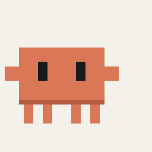
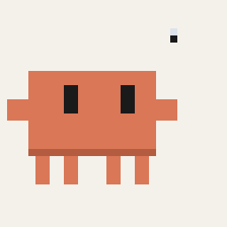
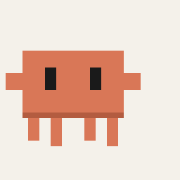
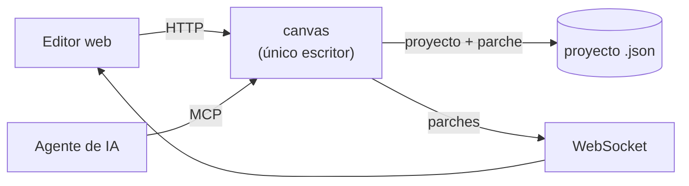

<div align="center">





# Pixel Studio API

**Un editor de sprites en pixel art con el que tu agente de IA puede dibujar.**
Cada cuadro de arriba lo dibujó Claude a través del servidor MCP de esta API.

[English](README.md) · **Español**


</div>

---

Pixel Studio es un editor de sprites local y pequeño, con animación cuadro a cuadro. Las personas dibujan en el [editor web](https://github.com/FernandoMVG/pixel-studio-web); los agentes de IA dibujan con **los mismos comandos** por MCP, y cada cambio aparece en vivo en el editor.

Este repo es el servidor: la lógica de dibujo, los archivos de proyecto, HTTP + WebSocket y el endpoint MCP.

## Pensado para agentes

Los agentes leen y escriben sprites **como texto**. Una letra por píxel, una línea por fila, `.` es transparente:

```text
10 ....OOOOOOOOOOOOOOOOOO..........
11 ....OOOOOOOOOOOOOOOOOO..........
12 ....OOOOOOOOOOOOOOOOOO..........
13 ....OOOOKKOOOOOOKKOOOO..........
14 .OOOOOOOKKOOOOOOKKOOOOOOO.......
```

Cuando un comando está mal, el error le dice al agente exactamente cómo corregirlo:

```text
Fila 3 tiene 15 caracteres, se esperaban 16
Color 'X' no existe en la paleta. Disponibles: . B D W K
```

## Inicio rápido

```bash
git clone https://github.com/FernandoMVG/pixel-studio-api.git
cd pixel-studio-api
npm install
npm run dev
```

La API escucha en `http://127.0.0.1:4317`: HTTP, WebSocket en `/ws` y MCP en `/mcp`. Los proyectos se guardan como archivos `.json` en `~/PixelStudio/proyectos`.

## Conecta tu agente

Con [Claude Code](https://claude.com/claude-code):

```bash
claude mcp add --transport http pixel-studio http://127.0.0.1:4317/mcp
```

Luego pídele algo como *"crea un proyecto de 32×32 y dibuja un gato que parpadea"*. Cualquier cliente MCP con HTTP *streamable* funciona igual.

| Herramienta | Qué hace |
|---|---|
| `list_projects`, `get_project` | Tamaño, paleta y animaciones |
| `get_frame` | Un cuadro como texto, una fila por línea |
| `set_rows` | Reemplaza filas completas: la forma más rápida de dibujar un sprite |
| `set_pixels`, `fill` | Píxeles sueltos y bote de pintura |
| `add_frame`, `delete_frame`, `set_hold`, `set_fps` | Cuadros, duración por cuadro y velocidad |
| `add_animation`, `rename_animation`, `set_palette` | Animaciones y paleta |
| `undo`, `redo` | Solo toca los cambios del agente, nunca los tuyos |
| `export_png` | Dibuja un cuadro para que el agente vea su propio dibujo |
| `create_project`, `delete_project`, `delete_animation` | Según los permisos que controlas desde el editor |

## HTTP y WebSocket

| Método | Ruta | |
|---|---|---|
| `GET` `POST` | `/projects` | Listar y crear |
| `GET` `DELETE` | `/projects/:id` | Leer y borrar |
| `POST` | `/projects/:id/commands` | Aplica comandos de dibujo, devuelve parches |
| `POST` | `/projects/:id/undo` · `/redo` | Historial por sesión |
| `GET` | `/projects/:id/export/frame.png` · `sheet.png` · `animation.gif` · `animation.txt` | Exportaciones, escaladas con *nearest neighbor* |
| `GET` `PUT` | `/settings` · `/settings/agent` | Permisos del agente |
| `GET` | `/agent/activity` | Lo que ha hecho el agente |
| `WS` | `/ws` | Parches en vivo y eventos de proyectos |

## Cómo funciona



- **Un solo escritor.** Todo cambio, venga de una persona o de un agente, pasa por los comandos de `canvas`. Cada uno devuelve el proyecto nuevo más un parche `{x, y, before, after}`, y deshacer/rehacer se construye sobre esos parches.
- **Dominio puro.** `src/features/` (`projects`, `canvas`, `animations`, `export`, `agent`) no sabe nada de archivos ni de red. El transporte y el almacenamiento viven en `src/infra/`.
- **Entrada validada.** Zod revisa cada comando, con mensajes escritos para que el agente se autocorrija.
- **Pequeño a propósito.** Lienzos de 8 a 32 px por lado, paleta fija de 4 a 6 colores con claves de una letra, escalado siempre con *nearest neighbor*.
- **Local y simple.** Un archivo `.json` por proyecto, detrás de una interfaz `ProjectStore`. Sin base de datos.

## Configuración

Copia `.env.example` a `.env` para cambiar los valores por defecto:

| Variable | Por defecto | |
|---|---|---|
| `PIXEL_PORT` | `4317` | Puerto de la API |
| `PIXEL_PROJECTS_DIR` | `~/PixelStudio/proyectos` | Dónde se guardan los proyectos |
| `PIXEL_SETTINGS_FILE` | `~/PixelStudio/ajustes.json` | Ajustes que guarda la app |
| `PIXEL_AGENT_CAN_CREATE` | `true` | El agente puede crear proyectos |
| `PIXEL_AGENT_CAN_DELETE` | `false` | El agente puede borrar proyectos y animaciones |

## Desarrollo

```bash
npm test            # Vitest
npm run typecheck   # tsc --noEmit
```

El editor web importa los tipos de este repo directamente (`src/contract.ts`), así que si trabajas en el editor clona los dos repos uno al lado del otro, como `pixel-api` y `pixel-web`.

## Licencia

[MIT](LICENSE)
