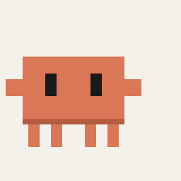
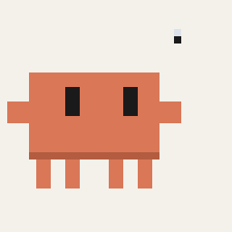
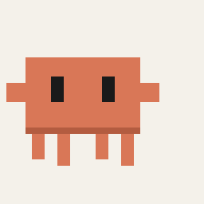
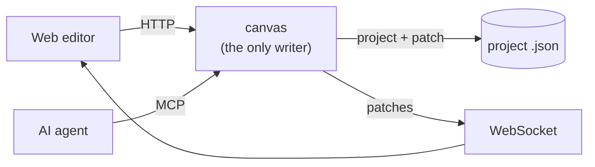

<div align="center">





# Pixel Studio API

**A pixel-art sprite editor your AI agent can draw with.**
Every frame above was drawn by Claude through this API's MCP server.

**English** · [Español](README.es.md)


</div>

---

Pixel Studio is a small, local sprite editor with frame-by-frame animation. People draw in the [web editor](https://github.com/FernandoMVG/pixel-studio-web); AI agents draw with the **same commands** over MCP, and every change shows up live in the editor.

This repo is the server: the drawing logic, the project files, HTTP + WebSocket, and the MCP endpoint.

## Why it's agent-friendly

Agents read and write sprites **as text**. One letter per pixel, one line per row, `.` is transparent:

```text
10 ....OOOOOOOOOOOOOOOOOO..........
11 ....OOOOOOOOOOOOOOOOOO..........
12 ....OOOOOOOOOOOOOOOOOO..........
13 ....OOOOKKOOOOOOKKOOOO..........
14 .OOOOOOOKKOOOOOOKKOOOOOOO.......
```

When a command is wrong, the error tells the agent exactly how to fix it:

```text
Row 3 has 15 characters, expected 16
Color 'X' is not in the palette. Available: . B D W K
```

*(The real messages are in Spanish: `Fila 3 tiene 15 caracteres, se esperaban 16`.)*

## Quick start

```bash
git clone https://github.com/FernandoMVG/pixel-studio-api.git
cd pixel-studio-api
npm install
npm run dev
```

The API listens on `http://127.0.0.1:4317`: HTTP, WebSocket on `/ws`, MCP on `/mcp`. Projects are saved as `.json` files in `~/PixelStudio/proyectos`.

## Connect your agent

With [Claude Code](https://claude.com/claude-code):

```bash
claude mcp add --transport http pixel-studio http://127.0.0.1:4317/mcp
```

Then ask it something like *"create a 32×32 project and draw a cat that blinks"*. Any MCP client that supports streamable HTTP works the same way.

| Tool | What it does |
|---|---|
| `list_projects`, `get_project` | Size, palette and animations |
| `get_frame` | A frame as text, one row per line |
| `set_rows` | Replace whole rows: the fastest way to draw a sprite |
| `set_pixels`, `fill` | Single pixels and paint bucket |
| `add_frame`, `delete_frame`, `set_hold`, `set_fps` | Frames, per-frame duration and speed |
| `add_animation`, `rename_animation`, `set_palette` | Animations and palette |
| `undo`, `redo` | Only touches the agent's own changes, never yours |
| `export_png` | Renders a frame so the agent can look at its own drawing |
| `create_project`, `delete_project`, `delete_animation` | Behind permissions you control from the editor |

## HTTP and WebSocket

| Method | Route | |
|---|---|---|
| `GET` `POST` | `/projects` | List and create |
| `GET` `DELETE` | `/projects/:id` | Read and delete |
| `POST` | `/projects/:id/commands` | Apply drawing commands, returns patches |
| `POST` | `/projects/:id/undo` · `/redo` | History per session |
| `GET` | `/projects/:id/export/frame.png` · `sheet.png` · `animation.gif` · `animation.txt` | Exports, scaled with nearest neighbor |
| `GET` `PUT` | `/settings` · `/settings/agent` | Agent permissions |
| `GET` | `/agent/activity` | What the agent has been doing |
| `WS` | `/ws` | Live patches and project events |

## How it works



- **One writer.** Every change, from a person or an agent, goes through the `canvas` commands. Each returns the new project plus a patch `{x, y, before, after}`, and undo/redo is built on those patches.
- **Pure domain.** `src/features/` (`projects`, `canvas`, `animations`, `export`, `agent`) knows nothing about files or the network. Transport and storage live in `src/infra/`.
- **Validated input.** Zod checks every command, with messages written for an agent to self-correct.
- **Small by design.** Canvases from 8 to 32 px per side, a fixed palette of 4–6 one-letter colors, scaling always with nearest neighbor.
- **Local and simple.** One `.json` file per project, behind a `ProjectStore` interface. No database.

## Configuration

Copy `.env.example` to `.env` to change the defaults:

| Variable | Default | |
|---|---|---|
| `PIXEL_PORT` | `4317` | API port |
| `PIXEL_PROJECTS_DIR` | `~/PixelStudio/proyectos` | Where projects are saved |
| `PIXEL_SETTINGS_FILE` | `~/PixelStudio/ajustes.json` | Settings saved from the app |
| `PIXEL_AGENT_CAN_CREATE` | `true` | Agent can create projects |
| `PIXEL_AGENT_CAN_DELETE` | `false` | Agent can delete projects and animations |

## Development

```bash
npm test            # Vitest
npm run typecheck   # tsc --noEmit
```

The web editor imports this repo's types directly (`src/contract.ts`), so if you work on the editor, clone both repos side by side as `pixel-api` and `pixel-web`.

## License

[MIT](LICENSE)
